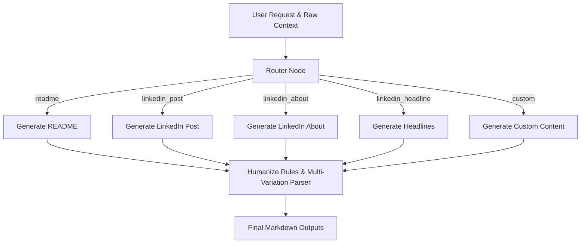

# ✍️ AI Developer Profile & Bio Writer Agent

[](https://www.python.org/)
[](https://www.langchain.com/langgraph)
[](https://groq.com/)
[](https://streamlit.io/)
[](https://opensource.org/licenses/MIT)

An autonomous agentic workflow built with **LangGraph** and **Groq (Llama 3.3 70B)** designed to eliminate marketing fluff, corporate jargon, and generic AI buzzwords from technical profiles. Generates crisp, humanized developer bios, GitHub READMEs, and high-impact LinkedIn content.

---

## 🧠 LangGraph State Machine Architecture



---

## 🎯 Humanization Rules Enforced
- **Zero Buzzwords:** Strips *"game-changer"*, *"passionate about"*, *"unleash"*, *"dive into"*, and corporate filler.
- **Concrete Metrics:** Encourages specific numbers (*"cut latency from 4s to 850ms"*) over vague adjectives (*"significantly improved"*).
- **Conversational Tone:** Natural sentence length variance and genuine first-person perspective.

---

## 🚀 Quickstart & Local Setup

### 1. Clone the repository
```bash
git clone https://github.com/30Piyush2025/PROFILE-WRITER.git
cd PROFILE-WRITER
```

### 2. Install dependencies
```bash
pip install -r requirements.txt
```

### 3. Set your Groq API Key
```bash
cp .env.example .env
# Edit .env and insert your GROQ_API_KEY
```

### 4. Run Interactive CLI or Web App

**Option A: CLI Terminal Mode**
```bash
python main.py
```

**Option B: Streamlit Web Dashboard**
```bash
streamlit run app.py
```

---

## 📂 Repository Structure

```text
PROFILE-WRITER/
├── app.py                          # Streamlit Web Application
├── main.py                         # Interactive CLI terminal interface
├── requirements.txt                # Project dependencies
├── .env.example                    # Environment variable template
├── src/
│   ├── agent_state.py              # TypedDict State schema for LangGraph
│   ├── prompts.py                  # Anti-buzzword prompt templates & router logic
│   └── graph.py                    # LangGraph compiled state machine & router
├── profile writer.ipynb            # Original research & Colab notebook
└── README.md                       # Documentation
```

---

## 👤 Author
- **Piyush** - [GitHub Profile](https://github.com/30Piyush2025)
